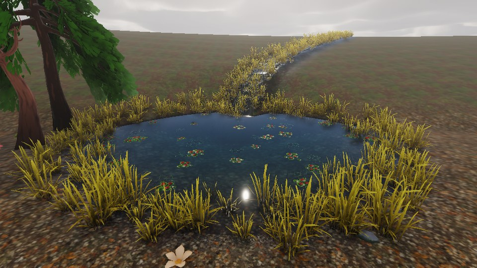
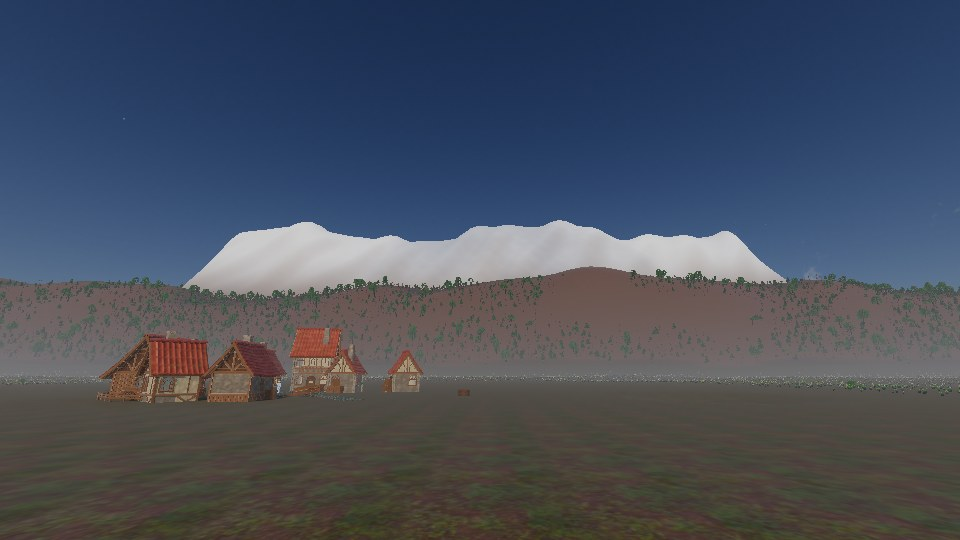
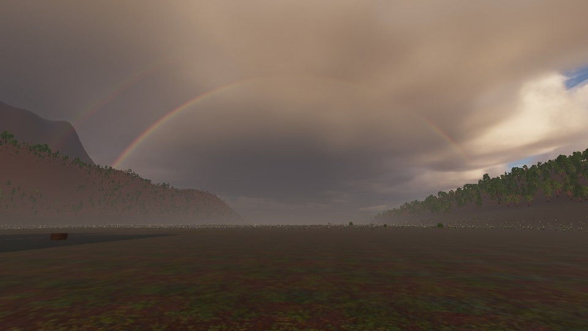
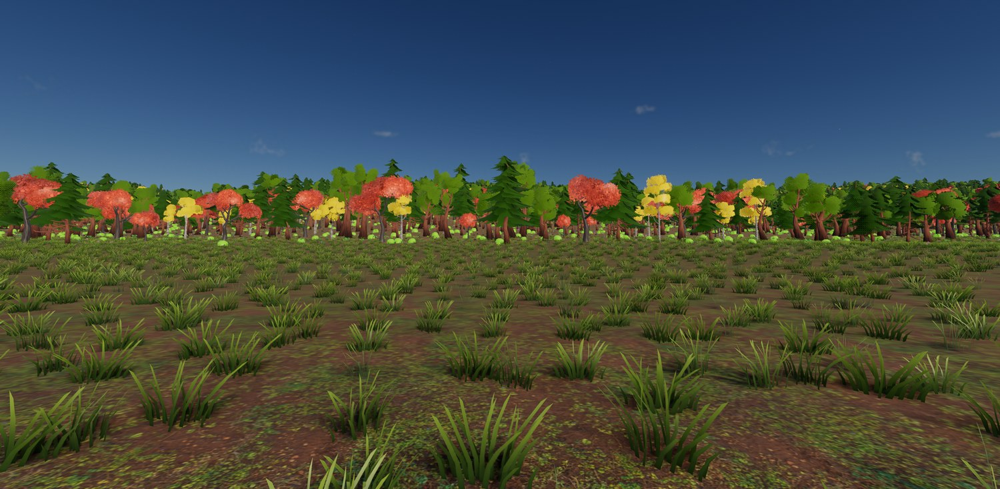
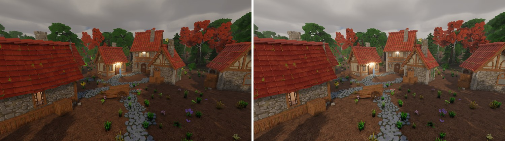
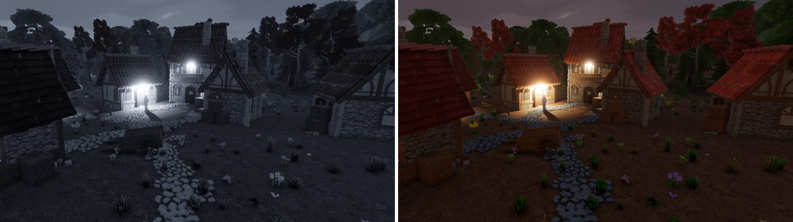
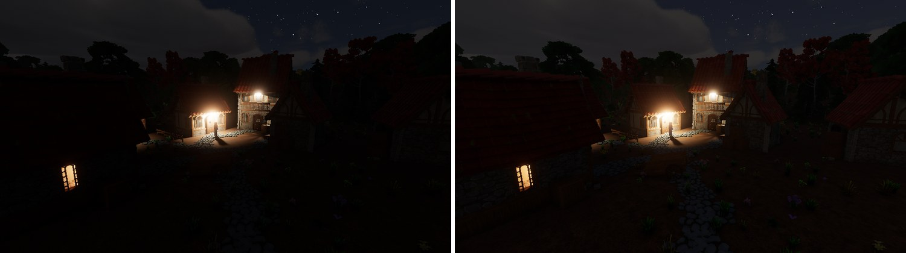

+++
description = "Four weeks on a laptop with an integrated GPU: the pond gets a surface, fog becomes a medium, the goldens leave git, and night stops being black."
tags        = ["c++", "gamedev", "engine", "rendering", "vulkan"]
+++

# gg, weeks 8 to 11: a pond, fog, night, and a month on a laptop

@tableofcontents

I spent the last four weeks travelling. The desktop and its 3070 stayed home, so everything in this post
was built and measured on the Meteor Lake laptop the quality tiers exist for. Its GPU is integrated and
every pass costs several times what it does at home. That turned out to be useful. A mistake that hides
in the noise on the 3070 is hard to miss here.

It also means none of this has run on the machine I normally use. I'm home again now and there's a list.

## Water, part 2

Part 1 ended with a pond-shaped hole and no water in it. It has a surface now.

_The demo basin's pond. The reeds grow where part 1's depth window puts them, the lily pads sit on the
still surface, and the stream feeding it is a carved river._

The scene pass splits at the sky. Opaque geometry draws first and gets copied aside. The water then
refracts into that copy: Snell's law down to the bed, absorption per channel along the path through the
water, in-scatter on the way back up, and Fresnel at water's f0 of 0.02. The surface is a second clipmap
that drops any patch the water field says is dry. There are no waves yet and it only reflects the sky.

The first version refused every refraction tap, and finding out why took ninety minutes. The frame is
960x540 inside a 1024x640 target. The new shader read the scene copy by uv, so every tap landed on the
wrong pixel and failed its depth check. The debug view for the refraction was the one view that had been
put off. When it finally existed it showed the whole pond as refused in its first frame.

@inline_attention **Write the debug view first.** A feature that draws an image has an intermediate, and
a broken intermediate usually composes into something that only looks a bit off. You need the view to
tune the feature anyway.

Light leaving water gets divided by the square of its refractive index. The plan left that out and the
pond came up 1.78 times too bright.

Anything under the surface is soaked. Its sun and sky are dimmed by the water above it and a fully porous
albedo darkens to 0.37. The wet film from the weather work takes the same surface down to 0.2 in air.

A frame with no water in view pays nothing. The first build read the water table behind a branch in every
lit surface shader, and with no water anywhere that cost 7.6% of the scene pass. The read is now a second
flavour of each pipeline. The renderer picks it per view, and only when a body of water is in that view.

## Goldens, out of git

Last post the golden images were eating the repository and I had a plan I hadn't committed to. It's done.
The images are release assets named by their own digest. Git holds one manifest per device, with a case
name and a SHA-256 on each line. Re-recording three cases is a three-line diff and three uploads.

The per-device part is new. The comparator is close to bit-exact by design, and two rasterisers disagree
by whole percentages. A tolerance wide enough for both would stop seeing real regressions. So a baseline
belongs to the device that drew it. There's a lavapipe set, which CI uses, and a set for this laptop's
GPU. A device with no set skips the comparison and still runs every other check in the case.

The laptop records its whole set in a minute and a half. Lavapipe needs an hour for the same frames, so I
stopped running it here. That set is now four weeks stale, and CI will be red on it until it's
re-recorded.

Leaving git cost me the before-and-after view my git client gave me for free. A script builds that page
now: every case that moved, side by side, with a flip, a swipe and an amplified difference.

## An integrated GPU

The scene colour target went from sixteen-bit floats to `B10G11R11`. Nothing reads its alpha, and the
smaller format halves the attachment: 35.4 MB to 17.7 at 1080p. The first build failed eighteen goldens.
Every frame had gone slightly darker, by less than one pixel's tolerance and by enough to fail the mean.
Intel's driver truncates when it stores into that format, and so does lavapipe. Every scene colour is now
rounded to the format's grid in the shader before it's written. That costs about half a millisecond here,
which is everything the format saved in the scene pass.

No Vulkan query reports whether a device rounds or truncates. So the renderer draws one colour three
quarters of the way between two steps and reads back which step it got. A device that rounds gets the
shader's rounding compiled out. I assume the 3070 is one of those. I'll know this week.

Mesh shaders went the other way. Last post's table had them winning on the ridge. On the laptop that arm
ran at 348 ms a frame. Mesa's Intel driver charges `vkCmdDrawMeshTasksIndirectCountEXT` for the maximum
count it's handed, whatever count it then reads. A region's maximum is its whole capacity: 70,708 slots
for 1,594 live entries. A mesh region is now a single launch through a task stage and that call is gone.
The frame dropped to 47.5 ms. Cooked index ranges draw it in 38.6. So `automatic` declines mesh shaders
on that driver and the 3070 keeps them.

The laptop's packaged validation layer is too old for Vulkan 1.4, so nothing here had been running under
validation. With a current SDK installed it found five defects in a day. One had been on screen the whole
time. Since the Vulkan port the window had been showing the frame squashed with a margin beside it,
because the present blit copied the whole padded target. Every test renders offscreen. Oops.

And this driver draws a stray triangle. One or two frames in a hundred carry a triangle whose vertices
belong to something else in the scene. The mesh path never does it and one driver option halves it. As
far as I can tell it isn't mine. The visual tests set the option.

## The air

The demo basin is too small to hold weather, so weather got a scene: the village on two kilometres of
ground that climbs to a 600 m ridge.

Rain or snow is now decided by the air at each surface's height.

_The snow line sits 308 m up, where the air is at one degree._

The clouds used to drift by adding the wind up frame by frame, so there was no way to compute where the
rain was at a given hour. The drift is now the wind integrated over game hours from the start of the
year. Rain at a point is a pure function of the clock, a game can ask for it across the C ABI, and the
ground under a passing shower is wet where the shower has been. The price is sensitivity. By day 268 a
change of 0.2 mm/s in the wind moves the sky four kilometres. I can live with that.

While I was in there I found the clouds moving upwind. Every cloud texture was sampled at position plus
drift, so the sky went one way while the trees bent the other. Nobody had noticed, me included.

The bigger change is the air itself. The exponential haze is gone. One froxel volume replaces it in every
sky mode, and everything that fills air goes through it: a ground fog layer, fog volumes, the rain's
veil, lamps lighting the mist around them, and a rainbow. Fog forms the way radiation fog does. It needs
damp ground, still air and a clear sky. It builds from evening through dawn and burns off once the sun
is past 25 degrees. At the demo's latitude that's 244 hours of the year.

_The bow is geometric optics: a table of zero to two internal reflections in a drop, convolved by the
sun's disc. The primary sits at 42.4 degrees with red on the outside._

The march cost 14.6 ms at the high tier on the laptop when it first worked. Stopping it from asking
shadow cascades it had already left took it to 12.7. Halving its steps per slice took it to 6.8, and I
couldn't tell the frames apart. The plan budgets 0.6 ms on the 3070. I don't know yet whether it gets
there.

## A forest

Foliage got a scene too: a kilometre of wood with 8,945 trees and 44,776 pieces of undergrowth.

_The wood from its meadow._

A tree made of leaf cards is lit as a pile of cards, each facing wherever it happens to face. The cook
now bends a crown's normals toward an ellipsoid fitted over it, so the tree is lit as one volume. It also
bakes an occlusion term per vertex by rasterising the model from 64 directions, so cards deep in a crown
come out darker than cards on its surface. That adds 0.85 s to a tree's cook and nothing I can measure to
a frame.

Distant crowns thin out by dropping whole cards. The coarser levels keep a half, a quarter and a tenth of
them, and the survivors' alpha is scaled up to make up the area that went.

Leaves also glow when the sun is behind them. The first version put a select on the shadow lookup of
every lit surface. It cost 4 to 8% of the scene pass, on scenes with no leaves in them at all. Eighteen
goldens had been re-recorded for it before that number existed. Backed out. It came back as a pipeline
variant that only transmissive materials use. The forest pays 5.5% for it and nothing else pays anything.

@inline_success **Pro-tip:** Measure a shader change against the shipped module before you record a
single frame for it. A golden tells you the image is right. It has no opinion about what the image cost.

## The review

At the end of September I stopped adding things. The engine had grown fast for two months and too much of
it was sized to whatever got the demo scene working. So the whole codebase went through a review with one
question: is this the implementation a real engine would ship? It came back with 190 findings across
fifteen areas. Working through them took most of two weeks.

The embarrassing one was normal maps. The cook generated tangents with the wrong handedness for any mesh
that didn't author them, so those meshes read a normal map's green channel upside down. Then the packs.
Six of the village kit's eight normal maps are authored green-down, and one ships with red and green
swapped. A PNG doesn't record which way up it is. The pixels do, though. A normal map baked from a
surface is the gradient of a height field and has no curl. The pack builder now reads each map four ways,
takes the reading with the least curl, and warns when that disagrees with what the map claims to be.

_The village before the review and after it. The roof tiles catch the light the right way up, the tonemap
rolls saturated highlights toward white, and the scene meters its exposure._

Some of the rest:

- The ACES curve was Narkowicz's fit. It's Hill's fit of the RRT and ODT now, with middle grey held where
  it was.
- A negative scale mirrors an entity properly. Winding and tangent frames follow it.
- Undo has a byte budget.
- A game can run a parallel-for on the engine's worker pool, and ask for assets ahead of needing them.

## Night

I opened the demo, dragged the clock to midnight and got a black screen. No sky, no moon, nothing. The
renderer could draw a night. The demo scene had a fixed exposure of 1.0, and a full-moon night wants about
116.

Turning on metering and rod vision fixed midnight and broke dusk. Rod vision is one blend over the whole
frame, keyed on the metered luminance. The first band made dusk look like a black-and-white filter with
one vivid red tree left in it.

_Dusk under the first rod-vision band, and under the one that shipped._

The catch is that a moonlit night meters brighter than late twilight: 0.0015 against 0.0006. No band on
that number can grey the night without greying twilight first. I took a low band and capped the exposure
at 8.

Then the two bodies. One of the sun and the moon used to drive both the direct light and every scattering
table, so the sun's twilight glow vanished the moment a risen moon outshone it at the ground. Both scatter
now. The direct light goes to whichever delivers more. The clouds and the fog each hand over separately
and fade across the change.

The last piece was how much the cloud layer dims the ambient. That was measured along the light, and a
slanting moon shines through more cloud than sits overhead. It's measured straight down now.

_Midnight under a full moon, before and after that last change._

Stars glow again as well. The bloom's first level weights by luminance to kill fireflies, and that
weighting kept about 1% of a star's light. Stars now draw a second time straight into that level.

## Hitches

A game can now ask for assets before it needs them. Workers do the reads and the frame commits what
they've read under a byte budget. The feature was the easy part.

- The frame that first touched a new allocator block paid to populate all of it: 35 ms at 256 MiB.
  Blocks are 64 MiB now and the arenas exist before anything asks for them.
- One buffer copy was costing 1.4 ms of command recording. Mesa's Intel driver searches for a way to
  factor a copy's length and some lengths take a while. Copies go out in spans it resolves at once.
- Spawning a thousand parented entities in one tick took 82 ms. It takes 0.7.
- Releasing a sculpt stroke re-cooked the water whether or not the stroke had been near any. A release on
  dry ground went from 95 ms to 31.

All 457 models in the packs preload in 92 frames, as fast as the budget allows.

## Where it stands

The pond has a surface, the air is a medium, the forest is lit like a forest and night looks like night.

None of it has run on the 3070. The lavapipe baselines are four weeks behind. A lot of the device tests
have only run on Intel. Half the costs in this post want a second column. That's the first week back.

After that it's waves, then the clouds. The traversal slice still hasn't started.

## Credits

Everything in these shots that isn't engine is bought or borrowed:

- The buildings, props, trees, foliage and rocks are [Quaternius](https://quaternius.com/) kits: the
    Medieval Village and Stylized Nature MegaKits, bought as the paid source versions, plus the free
    Ultimate Stylized Nature set. All of it is released CC0, and he takes Patreon support.

- The ground materials are [Poly Haven](https://polyhaven.com/) textures, CC0.

- The type is [Inter](https://rsms.me/inter/) by Rasmus Andersson, under the SIL Open Font License.
