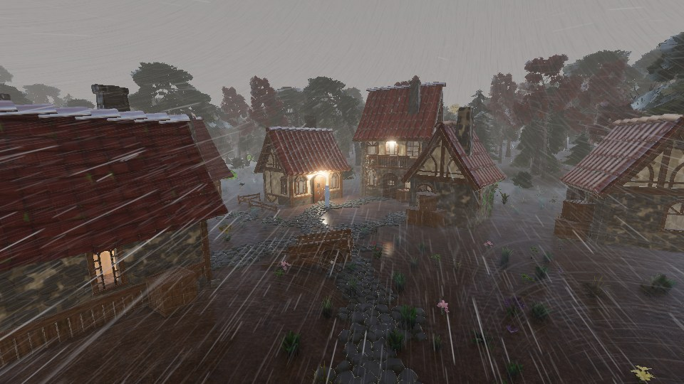
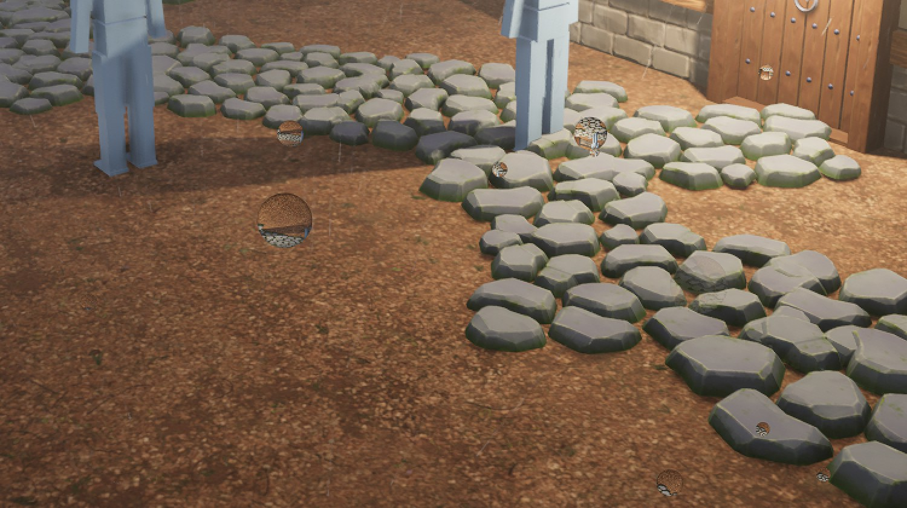
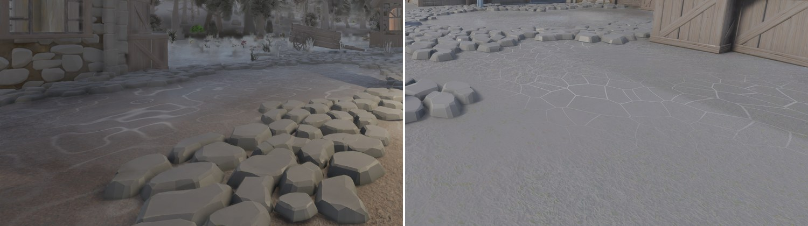
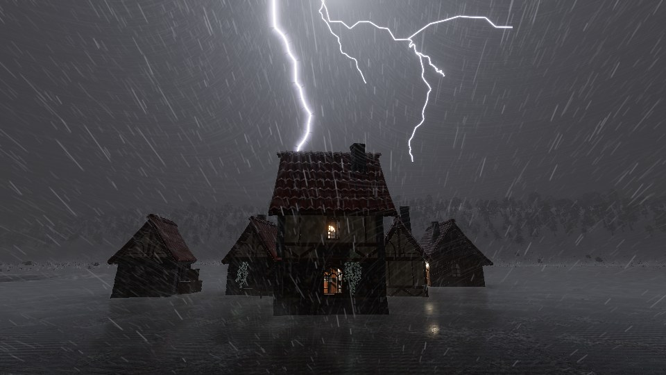
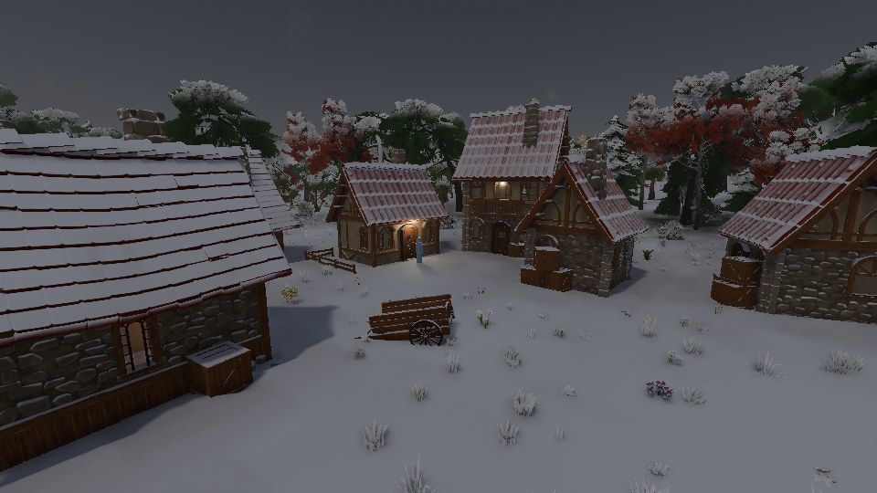
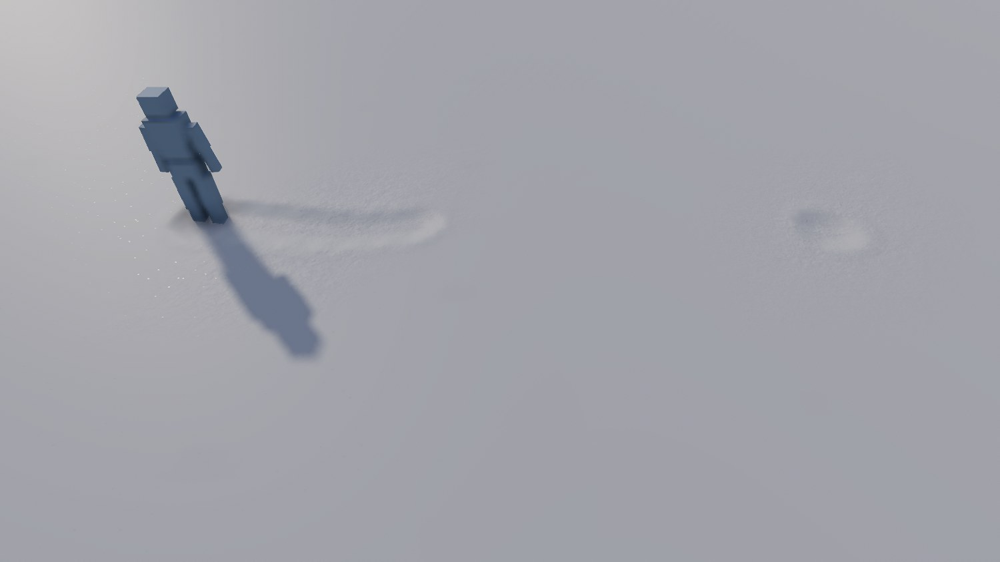
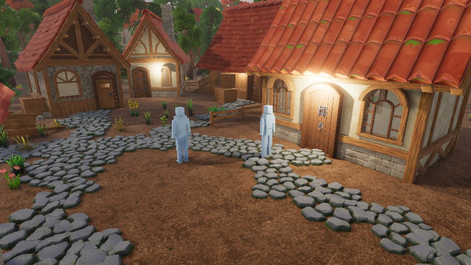
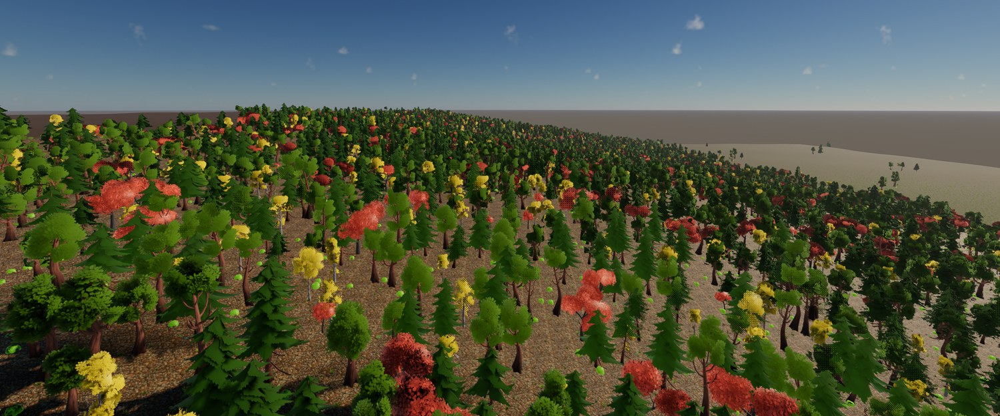
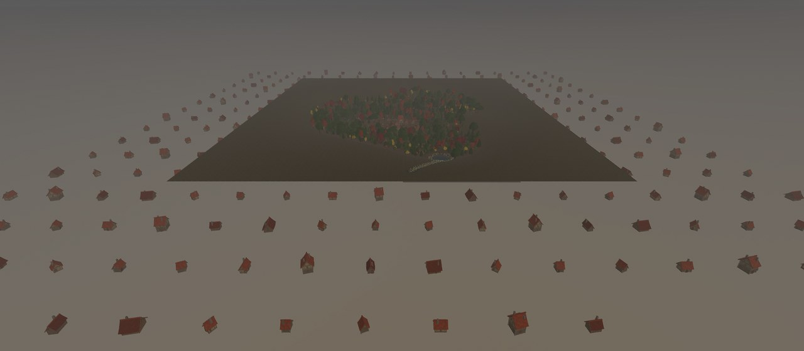

+++
description = "Back on the desktop: the weather starts dropping things, the goldens move onto the GPU, a scene gets more than one body to steer, and leaves hang off branches."
tags        = ["c++", "gamedev", "engine", "rendering", "weather"]
+++

# gg, weeks 12 to 15: rain, snow, lightning, and back on the 3070

@tableofcontents

The last post covered four weeks on a laptop and ended with a list of things to check once I was back on
the desktop. Well, I'm back, and the very first thing the desktop did was run the game at 0.2 fps. More on
that in a moment.

Once that was sorted out, most of the past month went into weather. The last couple of posts gave the sky
clouds and fog and gave the ground a wet film and a dusting of snow, but nothing ever actually fell out of
the sky. Now it does. It rains, snows, sleets and throws the occasional bolt of lightning, and the ground
floods, freezes and frosts over in response. There's also some work on cameras and possession, trees whose
leaves finally hang off their branches, and a town of three hundred buildings that are mostly standing on
nothing.

## The 3070

On the morning the last post went up, Ubuntu's unattended upgrades replaced the NVIDIA driver's userspace
libraries while the old kernel module was still loaded. The two refuse to work together when their versions
differ, so as far as Vulkan was concerned the 3070 had simply vanished, and the only device left on offer was
lavapipe, Mesa's CPU rasteriser. The engine happily took it without saying a word and then spent several
seconds drawing each frame. The one warning it did print said nothing had been presented for five seconds and
suggested the window might be hidden, which was a bit rich. The window was right there in front of me, slowly
drawing the demo scene.

A reboot sorted the driver out. The engine now complains loudly when it ends up on a software device it
didn't ask for, both in the log and in red on the status bar, so that one won't sneak past me again.

@inline_success **Pro-tip:** If a Linux machine with an NVIDIA card suddenly renders like a slideshow, run
`nvidia-smi`. "Driver/library version mismatch" means an update swapped the userspace driver out from under
the loaded kernel module, and Vulkan may have quietly fallen back to lavapipe. Reboot.

With the desktop working again I could finally answer the questions the last post left hanging. I'd assumed
the 3070 rounds when it writes to a `B10G11R11` target and could skip the rounding the shader does by hand.
Nope. It truncates, just like Intel's driver and lavapipe do. The shader keeps doing the rounding, and the
code path for a device that rounds has still never run on anything I own. The fog march the plan budgeted at
0.6 ms on this card comes in at 0.47 at the high tier, so that's one budget met. And NVIDIA's shader compiler
turned out to be painfully slow from a cold cache: a fresh start spent 49 seconds creating pipelines, until
they moved onto the worker pool and that dropped to 14.

## Goldens on the GPU

The lavapipe golden images were four weeks out of date by the time I got home, so I dutifully re-recorded
them, and then a couple of weeks later I retired them altogether.

The trouble with lavapipe is that it doesn't scale. Every golden case is a frame rasterised on the CPU and the
suite keeps growing, so by the end of October a full run of the visual tests took 48 minutes, while the 3070
gets through a bigger suite in 14. I don't have a server farm. I do have a reasonably powerful GPU, though,
and I care a lot more about making progress than about two different machines drawing identical pixels.

So the goldens are now recorded and compared on whatever device is running them, with a separate set for each
device. CI lost its visual tests in the process, since its runners don't have a GPU. The device layer's tests
still run there on lavapipe.

## Rain

_A storm in the village. Each streak is a particle, and the haze behind them is the same rain drawn as a
veil._

Rain gets drawn three different ways, depending on how far away it is. Close to the camera it's actual
particles: a pool of lanes simulated in a compute shader, about 130,000 of them at the high quality tier.
Each drop takes its diameter from
[Marshall and Palmer's](https://doi.org/10.1175%2F1520-0469%281948%29005%3C0165%3ATDORWS%3E2.0.CO%3B2)
1948 fit to measured raindrop sizes, and falls at the terminal speed that
[Atlas, Srivastava and Sekhon](https://doi.org/10.1029/RG011i001p00001) fitted for a drop that size.

Further out, a veil draws the same rain per pixel as a few layers of streaky texture, and past that the fog
medium carries what's left of it as extinction. All three are driven by one figure for how much rain is in
the air, so they agree where they meet. That figure gets big quickly. Rain at a fairly heavy 10 mm/h holds
about 250 drops bigger than a millimetre in every cubic metre of air, and the 16 m box of rain around the
camera holds roughly a million of them. That's a few too many particles. Each lane therefore represents a
whole crowd of drops and takes its opacity from how many it represents at that spot, so none of the rain's
look is tuned by hand.

Snow comes out of the same pool. Each lane checks the air temperature at its height to decide whether it's a
raindrop or a snowflake. Within about a degree of freezing it could go either way, and there's your
sleet. Flakes drift down at about a metre a second regardless of their size, and one that falls far enough
into warm air melts into a drop on the way down.

There's a fair bit of smaller stuff around all that. Drips fall from eaves, from the edges of bridges and
canopies, and from anywhere else the height field drops away by more than a metre. They keep going for a
while after the rain stops. A strong enough wind picks up leaves and dust from a sprite sheet the game
provides, and over lying snow it streams loose grains along the surface. Characters get wet, too. One
standing out in heavy rain is soaked in about ten seconds and takes a few minutes to dry off under a roof,
and if you leave it under an eave while it's still soaked, it drips off its shoulder.

Getting all of this to look right took a lot of actually looking at it. The first version of the veil
scrolled upwards, so the rain fell up. The first snowflakes got sheared into long swooshes by the same lean
that slants the rain. At one point a clamped texture sampler made the veil completely flat in rain and
invisible in snow, and every single test passed. All of those were obvious the moment anybody looked at a
frame. It's a lesson I seem to have to keep learning.

Rain can land on the camera, too, if a viewpoint asks for it. The tonemap pass draws the drops sitting on the
glass, and since a water drop is basically a tiny but very strong lens, each one shows a little upside-down
copy of the frame behind it. They grow, sit there for a bit, slide down and evaporate, all on a clock that
stops when the game is paused.

_Drops on the lens, blown up to 2x so the upside-down yard in each one is visible._

While I was staring at storm frames I also noticed the sun leaking through the clouds. A constant in the
cloud shadows let 35% of the direct sunlight through however thick the cover was. That's where the hard
shadows on overcast days had been coming from all along. Fixing it promptly turned overcast frames black
under a bright sky, and made snow blue. It turns out the leak had been quietly faking the light a cloud layer
scatters down onto the ground. So a closed cloud layer now passes 40% of the open-ground light on as an even
sky in the sun's colour, and overcast days finally look overcast.

And it rains more often. Rain used to wait for the cloud cover to close, but a shower can now fall out
of a sky that's mostly open. That roughly doubled how much of the year it rains, from about 11% to 23%. As a
nice side effect, rain falling while the sun is out is exactly what you need for a rainbow.

## Standing water and ice

Flat ground can hold water now. The terrain cook bakes a potential for standing water into the ground (most
of a level floor, all of a hollow, none of a crown), and a mesh pools wherever it's flat and sealed, so a flat
roof collects water while a gravel path soaks it up. Puddles fill up when it rains and dry out again
afterwards. In a shower they're covered in rings from the drops, and wind ruffles them into wavelets. Their
reflections come from a new screen-space mirror, and the environment fills in wherever its march misses.

The first wavelets were a sine multiplied by a cosine. At 1080p that looked exactly like corduroy. They're
three bent wave trains now, broken up into patches.

When the air drops below freezing, the wet film on everything freezes with it. A road glazes over clear while
a fence post frosts white, because a porous surface turns half of its ice to rime, and a frozen puddle becomes
a sheet of ice with cracks running through it. The cracks took two goes.

_The first cracks were contours of a noise function, and drew a jigsaw puzzle on the ice. Now they're the
edges of a jittered lattice._

Frost just needs the right kind of night: clear, calm and damp. By morning the ground is white, and then a
sunlit surface loses most of its frost while a shaded one hangs onto it for longer.

@inline_attention **Judge a new look at full size.** The golden images are only 960x540, and that hid
both the corduroy and the jigsaw. At 1080p they were obvious the first time anybody looked.

## Lightning and thunder

_A ground strike at night._

Lightning is decided once per tick. A hash of the weather's seed and the tick number is tested against a
strike rate, and that rate comes from the storminess: how hard it's raining, times how gusty it is, times how
much convective cloud there is near the player. So a steady stratus drizzle never throws lightning at you. And
because the draw only depends on the tick, the seed and where the player is, a replay gets every strike back
exactly.

A single strike is two to four strokes a few tens of milliseconds apart, and each one fades out within a few
milliseconds. The frame just samples whatever's lit at that instant, so the flicker you see is the real
thing. The flash lights every surface as well as the fog and the rain, and the clouds glow around where it
happened. One strike in four makes it to the ground. Those get a shadow-casting light and an actual bolt, built
by midpoint displacement seven levels deep with a few branches coming off it. The bloom takes care of
the rest. Auto-exposure is told to hold still while all this is going on, otherwise the whole frame would dim
for a moment after every flash.

Thunder follows from the strike. It's due at the strike's tick plus the strike's distance divided by 343 m/s,
so a strike 686 m away rumbles exactly two seconds after the flash. That makes thunder just another
tick-driven event: pausing the game holds it, and a replay reproduces it. It also plays from where the
strike actually was, so the rumble pans around as you turn.

The rest of the weather makes noise as well. A game lists its weather sounds in a `weather.toml` (light and
heavy rain, rain on a roof, wind, snow, thunder and drips), and the engine fades between them based on the
conditions at the listener. Under cover it also closes a low-pass filter over the rain. All of that plays on
a new fifth audio bus called `ambience`. It exists because the demo ducks its music under the effects bus,
and it turned out audible rain kept the music at half volume for as long as it was raining.

## Snow

Snow used to be a dusting of white with no depth to it. Now it actually lies on the ground. The terrain's
vertices rise by however deep the snow is, and the depth prepass, the scene and the shadows all draw that
same surface. Drifts pile up in the lee of walls and thin out in front of them.

_Noon after a snowfall._

It doesn't settle under anything a metre or more off the ground. That's why the yard is white and the ground
under the eaves is bare. The first version used twenty centimetres. That sounded perfectly reasonable right up
until every single tuft of grass left a little pockmark in the snow.

Walking through it cuts a trail, since a character on the ground clears the snow around its feet and pushes
up a little rim. Nothing ever fades a trail. It sticks around until the window that tracks it scrolls away.
The simulation's idea of the ground doesn't change, though, so feet sink into the snow and clicking on it hits
the ground underneath. Plants weighed down with snow also bend only half as far in the wind.

_A trail through fresh snow._

## Viewpoints and possession

Until now the engine had exactly one camera. The character you controlled was whichever one had been added
to the scene last, which meant adding a party member was an edit that quietly changed who you were.
Any entity can now carry a viewpoint and any character can be possessed, and the session decides which
viewpoint is in use and which body your input goes to.

Cameras work on claims. Anything that wants the view takes a claim and releases it when it's done, and the
newest claim wins. Editor claims always beat game claims, though. So if you grab the editor camera in the
middle of a cutscene and fly around for a bit, letting go puts you straight back into the cutscene.

The possessed body is a tick input, and a replay records which body each tick steered. That's enough for it to
reproduce a session that hopped between bodies without ever needing to know why it hopped.

_Two bodies to choose from, seen through a fixed viewpoint._

The orbit camera gained a boom. It sweeps a sphere out from the character's head and pulls the camera in
immediately when something gets in the way, then eases it back out more slowly, so a pillar sliding past the
lens doesn't make the camera pump in and out. The ears got split, too. Distance, occlusion and doppler are
measured from the character at head height, while panning comes from the camera. A sound at the
character's feet doesn't get quieter just because you orbited the camera away from it.

Animation also got a small piece of the motion phase early. The demo character switched between its idle and
walk clips by simply swapping one for the other, and it popped visibly. Clip switches are now
[inertialised](https://www.gdcvault.com/play/1025165/Inertialization-High-Performance-Animation-Transitions):
the pose keeps whatever offset it had at the moment of the switch and decays it away over a fifth of a second.
The character's furthest joint now moves 8.7 mm on the switch frame, where it used to jump 23.9 cm.

## Foliage

Trees already bent with a stiff trunk and fluttering leaves, but every leaf card fluttered at a random phase
and the branches simply moved with the tree. Now the leaves hang off the branches. The cook works out which
bit of wood each card hangs from and stores a lever and a phase in its vertices, so a branch swings on the
trunk while the leaves on it flutter together, and the next twig along moves out of phase with it.

For that to work the cook has to find whole cards. It does that by following each card's triangles and
matching vertices by position as well, since exporters split vertices along seams. Hanging each vertex off
whichever bit of wood is nearest would tear a card clean in half whenever its corners picked different twigs.
Plants made of a single material, like a tuft of grass, still bend as one piece. With their blades
fluttering against each other they look weirdly like an anemone.

Trees vary in colour, too. Each instance drifts a little in hue, saturation and value. Half of that drift
comes from a hash of the instance and half from a patch of noise about 40 m across, so a wood varies from tree
to tree as well as from stand to stand. The base of each plant takes on the colour of the ground it grows out
of, and a leaf can carry a thickness map that lets its veins hold back some of the light glowing through it.

_The forest from above, with the far shadow cascades drawing distant trees as impostors._

Impostors learned about depth. The bake stores each texel's height above its view's plane, and the quad steps
along the eye ray to that surface before sampling. Neighbouring views agree about where the silhouette is as a
result, and the error between them roughly halves. Distant trees also cast their impostors into the far
shadow cascades, which nearly halves the triangles those cascades redraw. A model with no impostor to swap to
dissolves away once it's only a few pixels across on screen.

Level-of-detail selection is a bit smarter as well. Opaque meshes now pick a level based on the error the cook
recorded for it, projected into pixels, so a rock that simplifies cleanly steps down much sooner than a wall
that's all corners. Foliage is the exception and still picks by radius. Under the error rule a tree's crown
kept every one of its leaf cards until it was only a few pixels across, and the forest got 18% more expensive
to draw.

## Scale

The scale plan needs a town to measure against, so there's now a verb that builds one: `stress-town 300`
copies the scene's buildings out onto a lattice, three hundred of them in a single undo record.

_Three hundred buildings, most of them standing on nothing, since the terrain ends at the dark square in the
middle._

A town where nothing is moving turned out to be doing a surprising amount of work every frame. The hierarchy
refresh now caches parents and skips anything that hasn't moved, and the scene index there costs half what it
did. With 100,000 instances in the scene, adding a single box used to rebuild the scene's entire item list,
which cost 21 ms. Arrivals and departures are patched in place now. The same box costs 2.3 ms.

I also found that an entity holding both a model and a generated shape made the scene rebuild its item list
every single frame, which at 100,000 instances took the frame time from 14.3 ms to 33.5. One entity! An entity
can only hold one drawable now, and trying to add a second kind gets refused.

The game UI produced the worst number of the month: sixteen thousand labels took 208 ms a frame, 192 of which
were spent in the UI pass alone. A whole UI tree now goes out in a single draw call, with one record per quad
that the vertex shader expands into six vertices. The same sixteen thousand labels take 17 ms.

## Odds and ends

- Music can change on the beat. A sound document can state a tempo and how many beats are in a bar, and a
  transition can then wait for the next beat or bar. The new track starts on the exact mixer sample the line
  falls on. Tracks can also loop between two points now, so an intro only plays once.
- French, Spanish, Italian, Portuguese and Catalan put a whole number of millions into a separate plural
  category called `many`, and the string tables now know that.
- The engine refuses to run with a host built against a different `runtime.hpp`, since the config's first
  field is a digest of that header and everything it includes. As part of that, `engine::create` takes the
  config by const reference: the Microsoft ABI destroys by-value arguments in the callee, so refusing a
  mismatched config would still have run the library's destructor over the caller's layout. Fun.
- A single failed upload used to stop every GPU readback for the rest of the session, which froze the
  exposure in place. A failed frame now only takes itself down.
- `get-pipelines` can report what the driver actually compiled. It explained why some leaf glow code was
  costing 0.07 ms on frames that don't even use it: the binary got about 6 KB bigger, and the register count
  didn't move at all.
- Stars dim and redden near the horizon, the way they're supposed to.
- The editor gained lasso selection and per-scene camera bookmarks: ctrl and a digit sets one, and the digit
  by itself jumps back to it.
- GCC builds again.

## Where it stands

The weather plan is done, and its page is gone from the repo.

The foliage plan still has leaf cards to draw at range, a shadow floor for the far field and ground cover to
go. Waves and the clouds are still waiting their turn, and the traversal slice still hasn't started.

## Credits

Everything that isn't engine is bought or borrowed:

- The buildings, props, trees, foliage and rocks are [Quaternius](https://quaternius.com/) kits: the
    Medieval Village and Stylized Nature MegaKits, bought as the paid source versions, plus the free
    Ultimate Stylized Nature set. All of it is released CC0, and he takes Patreon support.

- The ground materials are [Poly Haven](https://polyhaven.com/) textures, CC0.

- The sound effects are Imphenzia's
    [Universal Sound FX](https://www.imphenzia.com/universal-sound-fx), under a purchased licence.

- The type is [Inter](https://rsms.me/inter/) by Rasmus Andersson, under the SIL Open Font License.
